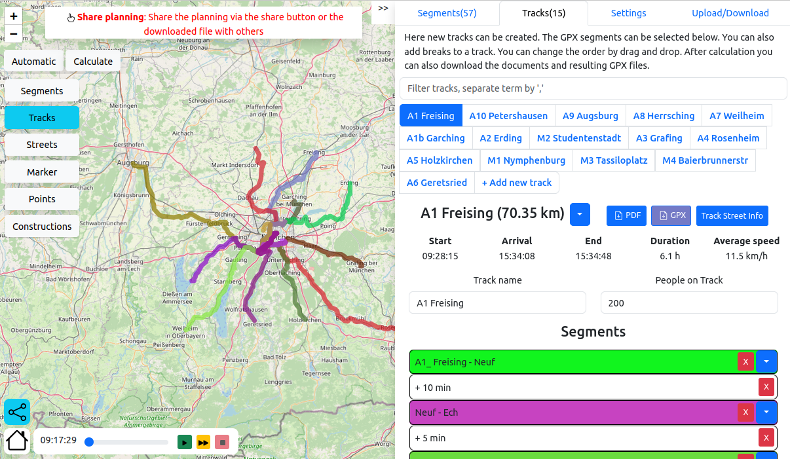
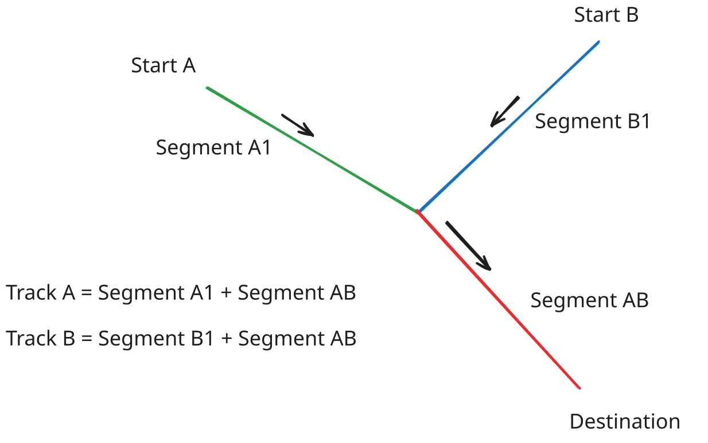
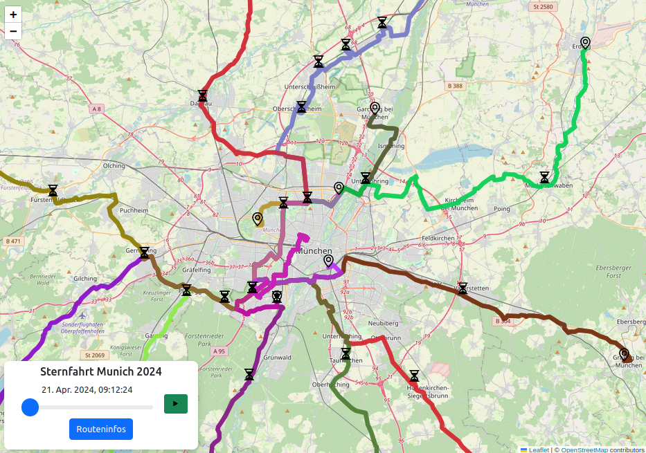
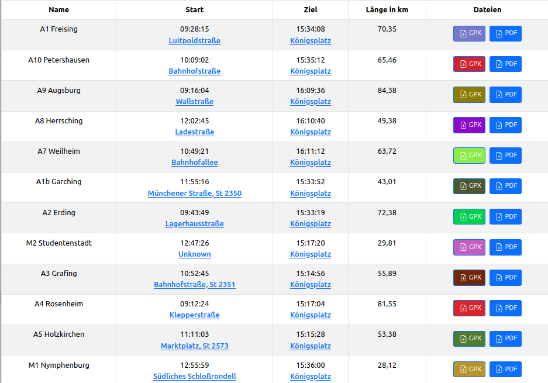
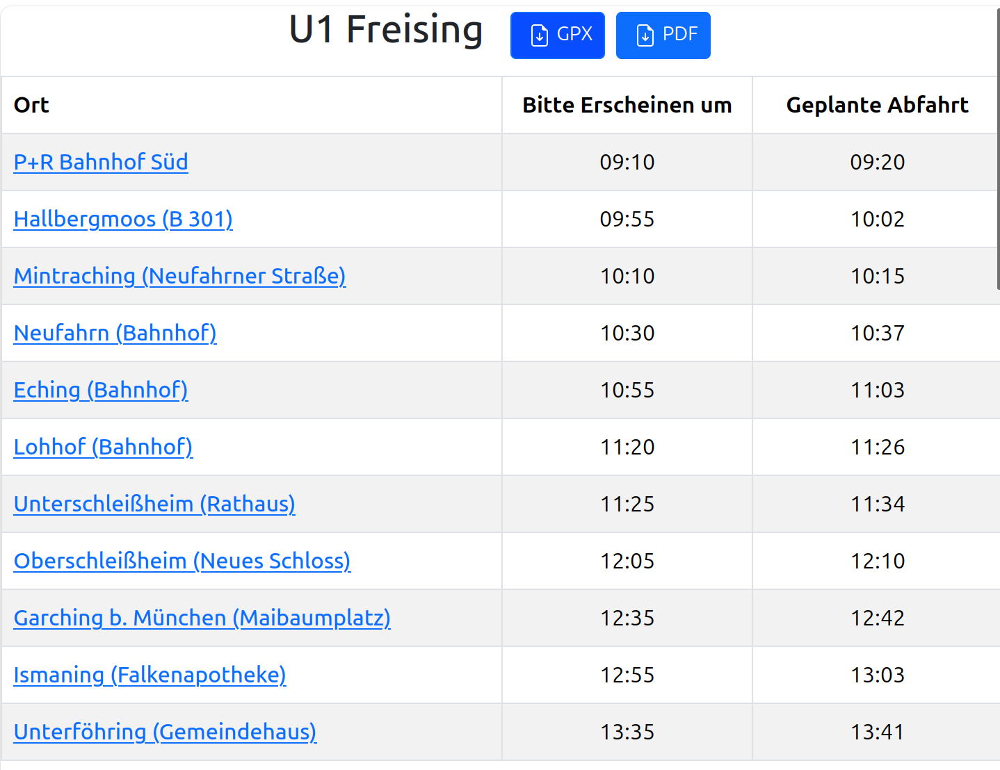
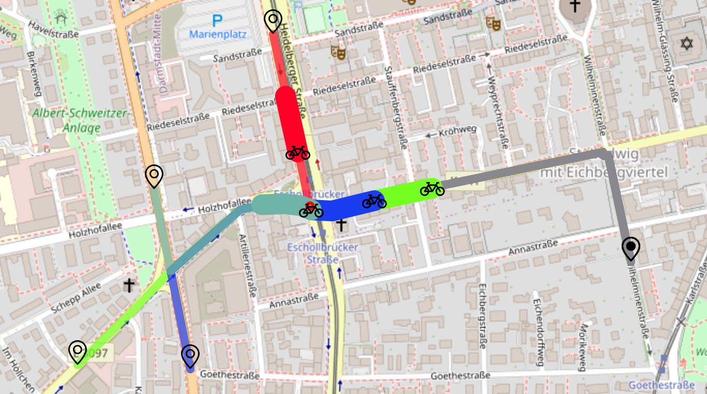
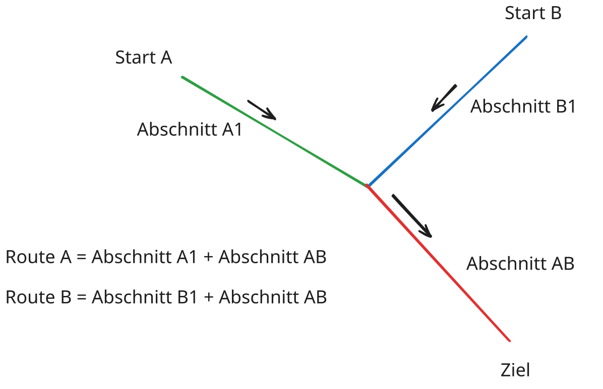

# RallyGPXMerger

A web tool to plan bicycle rallies from existing GPX route segments. The
frontend is React/TypeScript with Vite, and the optional persistence backend is
an Express service storing plan JSON files.

_"Planning a Sternfahrt becomes really easy"_ (Sternfahrt: German for a big star shaped bike demonstration)

Quote: Long-time Power User LeTaPe

## Current deployment

The current version of this tool is deployed here:
https://www.sternfahrtplaner.de/

The frontend is deployed as a static GitHub Pages site. Published plans are
loaded through the separately hosted persistence API.

You can find an example of a more complicated planning here:
https://www.sternfahrtplaner.de/?section=gps&planning=ce4e62a5-3b73-4fa1-80e3-d66d687c2439

## Why does this tool exist

When planning a bigger bike demonstration or rally it is a lot of work to not only decide about the routes. You also have to

- consider the timing, breaks, confluences of tracks
- communicate your tracks with officials
- communicate your tracks with participants
- apply changes and do all of it again

To ease these processes, this tool was developed to have an easy interface to the planning and reduce the manual work or copying information.
This tool does not provide any route planning because this is a common problem which is not unique to organizing rallies.
During the development it showed, that also for smaller bike demonstration it can help.
Therefore, now there are two modes of planning: one for a simple "line" demonstration and another one for more complex "tree" ones

### General functionality

- Start a new plan, continue an unfinished plan, or load a previously downloaded plan from a JSON file.
- Switch between English and German and send feedback from the planner.
- Automatic time calculation for the tracks
  - Set a general speed or individual speeds for segments.
  - Take participant numbers, participant delays, buffers, breaks, and joins into account.
- Preview the resulting demonstration with a time slider and selectable map layers.
  - Filter and toggle segments, tracks, nodes, breaks, entry points, points of interest, and construction sites.
- Upload, reorder, filter, download, remove, replace, reverse, and split GPX segments.
- Combine segments and breaks into tracks and edit the resulting track information.
- Automatically resolve street names, districts, and postcodes.
  - Highlight unknown streets and manually correct street names, districts, and postcodes.
  - Check plans for gaps and other incomplete or inconsistent settings.
- Add points of interest and timed entry points with configurable buffers and rounding.
- Add construction-site GPX files as map overlays.
- Download calculated tracks and source segments as GPX files, and export street information as CSV or PDF.
- Create a copy of a plan for later import or further editing.
- Live view with integration of the criticalMaps API
  - When participants use the CriticalMaps App, their location is displayed on the map.
- Creation of PDF files containing a detailed overview of the streets, breaks, entry points, nodes, and times.
- Allow to publish the plan as a map (https://www.sternfahrtplaner.de/?display=ce4e62a5-3b73-4fa1-80e3-d66d687c2439)
  
- Allow to publish the plan as a table (e.g. to integrate on your website) (https://www.sternfahrtplaner.de/?table=ce4e62a5-3b73-4fa1-80e3-d66d687c2439)
  
- Allow to publish the plan as a vertical table (e.g. to integrate on your website) (https://www.sternfahrtplaner.de/?vTable=6efaf495-a9f6-4308-87e1-fd5d2c8e7911)
  
- Share plans through public links and embed the map or tables in other websites.
- Overview tools for tracks, nodes, branches, arrivals, entry points, and the overall flow of a complex plan.

The application selects its public views from URL parameters: `display` for
the map, `table` for the regular table, `vTable` for the vertical table,
`comparison` for plan comparison, and `streetpath` for a street-path map.

### Simple ("Line")

Simple mode creates one ordered track from the uploaded segments. It is intended for demonstrations without branching or merging routes.

The workflow for a simple demonstration:

- Start a new Simple plan from the wizard and upload GPX segments into the browser.
- Reorder segments via drag and drop and edit them by replacing, reversing, splitting, or removing them.
- Integrate breaks into the track and configure its title, start and arrival times, buffer, participant count, speed, and participant delay.
- Use the planning checks to inspect gaps, unknown streets, points of interest, and planner settings.
- Download the calculated track or source segments, export the street information, or upload the planning to the server.
- Share or publish the planning in the form of a PDF, links, or iframes, as a map, table, or vertical table.

### Complex ("Tree")

Complex mode creates several named tracks that may branch, reuse segments, and merge at nodes. It is intended for demonstrations with multiple groups or routes.

The workflow for a complex demonstration:

- Start a new Complex plan from the wizard and upload GPX segments into the browser.
- Create, name, reorder, and filter tracks.
- Add segments to tracks. Segments can be used multiple times when different branches join.
- Integrate breaks into tracks and configure track-specific people, speeds, buffers, and timing.
- Name the planning and configure global settings such as arrival dates, start times, and rounding.
- Add entry points with a published arrival time, buffer, and rounding calculated from the current planning.
- Review gaps, unknown streets, points of interest, start names and times, track arrivals, node settings, and public links in the overview.
- Inspect the plan with the track overview, node overview, and flow overview.
- Download or upload the planning and share or publish it in the form of PDFs, links, or iframes, as a map, table, or vertical table.

#### Behavior at nodes

For trying out the behaviors, you find this simple planning here: https://www.sternfahrtplaner.de/?section=gps&planning=f9043eb9-2394-4d78-be27-481e96654411

##### Default behavior

Without any further setting, at a node the bigger group goes first, and then the smaller one(s) add behind.

##### Custom behavior

The tool allows to alter this behavior:

- Via settings priorities can be set (the higher the priority, the earlier a branch finishes)
- At each node the behavior can be specified:
  - Altering the order
  - Let the branches join at the same time

When two or more branches join at the same time, the size is not adopted.
The tool is based on a very simple simulation approach.
For the planning and the execution the times of the head of branches are important.
A more sophisticated approach would require detailed participant numbers, which are difficult to get.

### Starting, continuing, and sharing plans

The start page offers three planning actions:

- **Start a plan** opens the mode selection for a new Simple or Complex plan. Starting over warns before replacing an existing plan.
- **Continue a plan** returns to the current planning when one is already in progress.
- **Load a plan** imports a previously exported JSON planning. Loading over an existing planning asks for confirmation first.

Plans can be saved to the server, downloaded as a copy, imported again, and shared through generated public links. Public views are available as an interactive map, a regular table, or a vertical table, including iframe-friendly URLs.

### Comparison

Different plannings can be compared, to see the differences between them. Therefore, the planning ids have to be listed, like in this example:
Optionally the color for the plannings can be specified in hex codes, or altered in the comparison itself

https://www.sternfahrtplaner.de/?comparison=ce4e62a5-3b73-4fa1-80e3-d66d687c2439,2bf9d574-e3eb-4eb8-8759-762c34405160&colors=644ecf,befa2a

## Project structure

- `.github`: GitHub Actions workflow for testing and GitHub Pages deployment
- `docs`: Code Docs based on arc42
- `server`: Express/TypeScript persistence server storing `plans/*.json`
- `testdata`: Example Gpx files
- `website`: React 19, TypeScript, Redux Toolkit, and Vite frontend

## German naming sketch

## Acknowledgement

This tool would not be possible without external services which ease the creation of GPX files or retrieval of geo-data.

- [GPX Studio](https://www.gpx.studio/)
- [brouter](http://brouter.de/brouter-web)
- [GeoApify](https://www.geoapify.com/)
- [BigDataCloud](https://www.bigdatacloud.com/)
- [CriticalMaps](https://github.com/criticalmaps/)

---

## Deutsche Fassung

Ein Webwerkzeug zur Planung großer Fahrraddemonstrationen aus vorhandenen
GPX-Streckenabschnitten. Die Anwendung wurde mit React und TypeScript erstellt
und verwendet ein einfaches Backend, das JSON-Dateien speichert.

_„Die Planung einer Sternfahrt wird wirklich einfach“_

Zitat: Langjähriger Power-User LeTaPe

### Aktuelle Veröffentlichung

Die aktuelle Version dieses Werkzeugs ist hier verfügbar:
https://www.sternfahrtplaner.de/

Ein Beispiel für eine komplexere Planung findet sich hier:
https://www.sternfahrtplaner.de/?section=gps&planning=ce4e62a5-3b73-4fa1-80e3-d66d687c2439

### Warum gibt es dieses Werkzeug?

Bei der Planung einer größeren Fahrraddemonstration oder Sternfahrt ist es viel
Arbeit, nicht nur die Routen festzulegen. Zusätzlich müssen Sie:

- die Zeiten, Pausen und Zusammenführungen von Routen berücksichtigen,
- die Routen mit Verantwortlichen und Behörden abstimmen,
- die Routen den Teilnehmenden mitteilen,
- Änderungen einarbeiten und alle Informationen erneut erstellen.

Dieses Werkzeug wurde entwickelt, um diese Abläufe mit einer einfachen
Bedienoberfläche zu erleichtern und manuelle Arbeit sowie das Kopieren von
Informationen zu reduzieren.

Das Werkzeug erstellt keine Routen. Das ist ein allgemeines Problem, das nicht
spezifisch für die Organisation von Sternfahrten ist. Im Laufe der Entwicklung
zeigte sich, dass es auch für kleinere Fahrraddemonstrationen hilfreich ist.
Daher gibt es jetzt zwei Planungsarten: eine einfache „Linie“ und einen
komplexeren „Baum“.

### Allgemeine Funktionen

- Eine neue Planung starten, eine nicht abgeschlossene Planung weiter bearbeiten
  oder eine zuvor heruntergeladene Planung aus einer JSON-Datei öffnen.
- Zwischen Deutsch und Englisch wechseln und aus dem Planer
  **Feedback / Änderungswünsche** senden.
- Automatische Zeitberechnung für die Routen:
  - Eine allgemeine Geschwindigkeit oder angepasste Geschwindigkeiten für
    einzelne Abschnitte festlegen.
  - Personenanzahl, Verzögerung durch Teilnehmende, Startpuffer, Pausen und
    Zusammenführungen berücksichtigen.
- Die geplante Sternfahrt mit einem Zeitregler und auswählbaren Kartenebenen
  anzeigen.
  - Abschnitte, Routen, Knoten, Pausen, Einstiegspunkte, wichtige Punkte und
    Baustellen filtern oder ein- und ausblenden.
- GPX-Abschnitte hochladen, sortieren, filtern, herunterladen, entfernen,
  ersetzen, umdrehen und aufteilen.
- Abschnitte und Pausen zu Routen zusammenbauen und die Routeninformationen
  bearbeiten.
- Straßennamen, Bezirke und Postleitzahlen automatisch auflösen.
  - Unbekannte Straßen hervorheben und Straßennamen, Bezirke sowie PLZ manuell
    korrigieren.
  - Planungen auf Lücken und andere unvollständige oder widersprüchliche
    Einstellungen überprüfen.
- Wichtige Punkte und zeitlich berechnete Einstiegspunkte mit konfigurierbarem
  Puffer und Rundung hinzufügen.
- GPX-Dateien für Baustellen als Kartenüberlagerungen hinzufügen.
- Berechnete Routen und Quellabschnitte als GPX-Dateien herunterladen sowie
  Straßeninformationen als CSV oder PDF exportieren.
- Eine Kopie einer Planung für den späteren Import oder die weitere Bearbeitung
  erstellen.
- Live-Ansicht mit Integration der CriticalMaps-API:
  - Wenn Teilnehmende die CriticalMaps-App verwenden, wird ihre Position auf
    der Karte angezeigt.
- PDF-Dateien mit einer detaillierten Übersicht der Straßen, Pausen,
  Einstiegspunkte, Knoten und Zeiten erstellen.
- Eine Planung als Karte veröffentlichen
  (https://www.sternfahrtplaner.de/?display=ce4e62a5-3b73-4fa1-80e3-d66d687c2439)
  
- Eine Planung als Tabelle veröffentlichen, zum Beispiel zur Einbindung in eine
  Website
  (https://www.sternfahrtplaner.de/?table=ce4e62a5-3b73-4fa1-80e3-d66d687c2439)
  
- Eine Planung als vertikale Tabelle veröffentlichen, zum Beispiel zur
  Einbindung in eine Website
  (https://www.sternfahrtplaner.de/?vTable=6efaf495-a9f6-4308-87e1-fd5d2c8e7911)
  
- Planungen über öffentliche Links teilen und die Karte oder Tabellen in andere
  Websites einbetten.
- Übersichten für Routen, Knoten, Zweige, Ankünfte, Einstiegspunkte und den
  gesamten Planungsfluss einer komplexen Planung verwenden.

### Einfach („Linie“)

Der Modus **Einfach** erstellt aus den hochgeladenen Abschnitten eine einzelne,
sortierte Route. Er eignet sich für Demonstrationen ohne Verzweigungen oder
Zusammenführungen von Routen.

Der Ablauf für eine einfache Demonstration:

- Im Assistenten eine neue einfache Planung starten und GPX-Abschnitte im
  Browser hochladen.
- Abschnitte per Drag-and-drop sortieren und durch Ersetzen, Umdrehen,
  Aufteilen oder Entfernen bearbeiten.
- Pausen in die Route integrieren und den Demonamen, Start und Ankunft,
  Startpuffer, die Personenanzahl, Geschwindigkeit und die Verzögerung durch
  Teilnehmende konfigurieren.
- Mit den Überprüfungen Lücken, unbekannte Straßen, wichtige Punkte und die
  Einstellungen des Planers prüfen.
- Die berechnete Route oder die Quellabschnitte herunterladen,
  Straßeninformationen exportieren oder die Planung auf den Server hochladen.
- Die Planung als PDF, über Links oder Iframes sowie als Karte, Tabelle oder
  vertikale Tabelle teilen oder veröffentlichen.

### Komplex („Baum“)

Der Modus **Komplex** erstellt mehrere benannte Routen, die sich verzweigen,
Abschnitte wiederverwenden und an Knoten zusammengeführt werden können. Er
eignet sich für Demonstrationen mit mehreren Gruppen oder Routen.

Der Ablauf für eine komplexe Demonstration:

- Im Assistenten eine neue komplexe Planung starten und GPX-Abschnitte im
  Browser hochladen.
- Routen erstellen, benennen, sortieren und filtern.
- Abschnitte zu Routen hinzufügen. Ein Abschnitt kann mehrfach verwendet
  werden, wenn verschiedene Zweige zusammengeführt werden.
- Pausen in Routen integrieren und Personenanzahl, Geschwindigkeit, Puffer und
  Zeitplanung für einzelne Routen konfigurieren.
- Den Demonamen und globale Einstellungen wie Ankunftsdatum, Startzeiten und
  Rundung festlegen.
- Einstiegspunkte mit einer zu veröffentlichenden Ankunftszeit, einem Puffer
  und einer Rundung hinzufügen, die aus der aktuellen Planung berechnet werden.
- In der Übersicht Lücken, unbekannte Straßen, wichtige Punkte, Startnamen und
  -zeiten, Ankünfte der Routen, Knoteneinstellungen und öffentliche Links
  prüfen.
- Die Planung mit der Routenübersicht, Knotenübersicht und Flussübersicht
  untersuchen.
- Die Planung herunterladen oder hochladen und sie als PDF, über Links oder
  Iframes sowie als Karte, Tabelle oder vertikale Tabelle teilen oder
  veröffentlichen.

#### Verhalten an Knoten

Zum Ausprobieren der Verhaltensweisen gibt es hier eine einfache Planung:
https://www.sternfahrtplaner.de/?section=gps&planning=f9043eb9-2394-4d78-be27-481e96654411

##### Standardverhalten

Ohne weitere Einstellungen fährt an einem Knoten die größere Gruppe zuerst.
Die kleinere Gruppe beziehungsweise die kleineren Gruppen reihen sich dahinter
ein.

##### Benutzerdefiniertes Verhalten

Das Verhalten kann angepasst werden:

- Über die Einstellungen können Prioritäten gesetzt werden. Je höher die
  Priorität, desto früher wird ein Zweig fertig.
- An jedem Knoten kann das Verhalten festgelegt werden:
  - Die Reihenfolge ändern.
  - Die Zweige gleichzeitig zusammenführen.

Wenn zwei oder mehr Zweige gleichzeitig zusammengeführt werden, wird die Größe
der Gruppe nicht übernommen.

Das Werkzeug basiert auf einer sehr einfachen Simulation. Für die Planung und
die Durchführung sind die Zeiten der Köpfe der Zweige entscheidend. Eine
aufwendigere Simulation würde detaillierte Angaben zu den Teilnehmerzahlen
erfordern, die nur schwer zu ermitteln sind.

### Planungen starten, weiter bearbeiten und teilen

Die Startseite bietet drei Aktionen:

- **Neue Planung** öffnet die Auswahl zwischen einer einfachen und einer
  komplexen Planung. Wenn eine Planung bearbeitet wird, wird vor dem Ersetzen
  der aktuellen Daten gewarnt.
- **Planung weiter bearbeiten** öffnet die zuletzt bearbeitete Planung, wenn
  bereits eine Planung vorhanden ist.
- **Existierende Planung öffnen** importiert eine zuvor exportierte JSON-Datei.
  Wenn bereits eine Planung vorhanden ist, muss das Überschreiben bestätigt
  werden.

Planungen können auf dem Server gespeichert, als Kopie heruntergeladen, erneut
importiert und über öffentliche Links geteilt werden. Öffentliche Ansichten
sind als interaktive Karte, normale Tabelle oder vertikale Tabelle verfügbar
und können über iframe-freundliche URLs eingebunden werden.

### Vergleich

Verschiedene Planungen können verglichen werden, um die Unterschiede zu sehen.
Dazu müssen die IDs der Planungen wie in diesem Beispiel aufgelistet werden:

Optional können Farben für die Planungen als Hex-Codes angegeben oder direkt im
Vergleich geändert werden.

https://www.sternfahrtplaner.de/?comparison=ce4e62a5-3b73-4fa1-80e3-d66d687c2439,2bf9d574-e3eb-4eb8-8759-762c34405160&colors=644ecf,befa2a

## Projektstruktur

- `.github`: Dateien für die Bereitstellung über GitHub Pages
- `docs`: Codedokumentation nach arc42
- `server`: Express/TypeScript-Server für die Speicherung von `plans/*.json`
- `testdata`: Beispiel-GPX-Dateien
- `website`: React- und Vite-Projekt

## Deutsche Namensskizze

## Danksagung

Dieses Werkzeug wäre ohne externe Dienste, die das Erstellen von GPX-Dateien
oder das Abrufen von Geodaten erleichtern, nicht möglich.

- [GPX Studio](https://www.gpx.studio/)
- [brouter](http://brouter.de/brouter-web)
- [GeoApify](https://www.geoapify.com/)
- [BigDataCloud](https://www.bigdatacloud.com/)
- [CriticalMaps](https://github.com/criticalmaps/)
