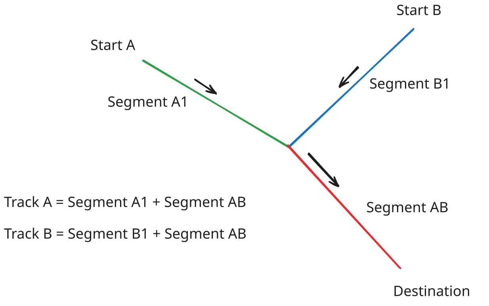

# Introduction and Goals

RallyGPXMerger helps organisers plan bicycle rallies from existing GPX route
segments. It does not create routes. It imports GPX segments, creates one or
more tracks, calculates timing, and publishes or downloads the result.

The Simple (Line) model creates one ordered track. The Complex (Tree) model
creates several named tracks that may reuse segments and merge at nodes.
Users can specify participant counts, speeds, breaks, buffers, start times,
arrival times, priorities, entry points, and other planning metadata.

A plan consists of GPX segments and planner settings. The application parses
the uploaded geometry, derives timed points from speed and elevation data, and
calculates track timing including participant expansion, breaks, and node
joins. It can export calculated tracks and source segments as GPX, street
information as CSV, and planning information as PDF.

## Requirements Overview

While planning a rally, routes can be created with external tools such as
[GPX Studio](https://gpx.studio/) or
[BRouter](http://brouter.de/brouter-web). This tool calculates rally timing,
including branch starts and joins, and makes the related route information
available through maps, tables, downloads, and PDFs.

## Quality Goals

A person without a lot of technical knowledge should be able to easily use the tool.
No code needs to be installed to use the functionality.

## Stakeholders

| Role/Name  | Expectations                                     |
| ---------- | ------------------------------------------------ |
| User       | Planing a rally easily with merging gpx segments |
| Maintainer | Being able to maintain the code long term        |
